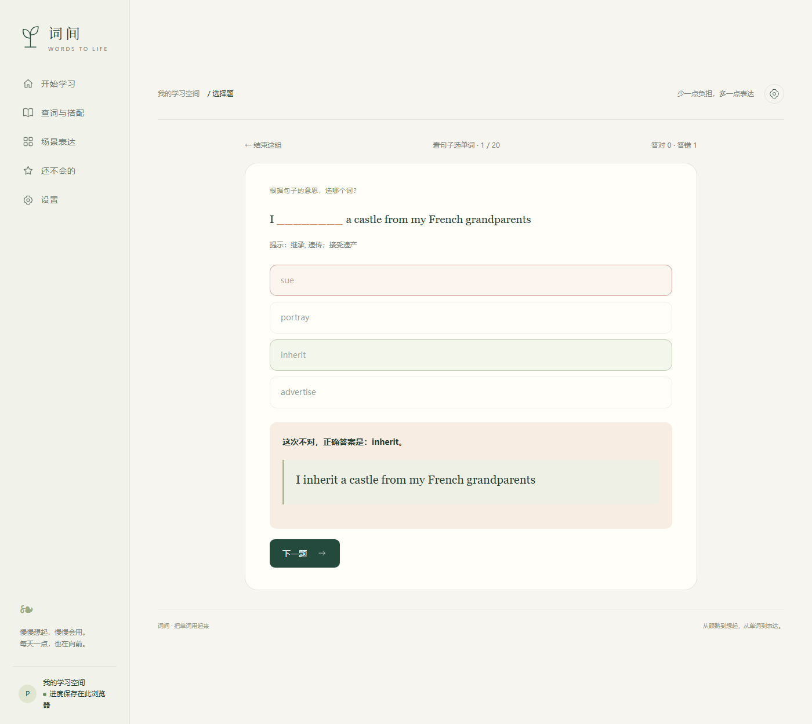

# 词间 · 把单词用起来

一个面向雅思备考的**主动回忆式**英语词汇练习网页。纯静态站点，无框架、无构建、无后端、无外部字体与运行库依赖。

**在线体验：** https://chenyidan2006.github.io/cijian-words/


---

## 为什么做这个

多数背词工具在解决"**没见过**"，但真正的痛点是"**看见认识、没有提示却想不起来**"——也就是从被动词汇到主动词汇的那一步。

词间把练习主线压缩到最短：**中文先出现 → 点击才看英文 → 选「想起了 / 还不会」→ 自动下一条**。

- 中文先出现，避免英文拼写和中文释义同时暴露，逼出真实回忆
- 不设每日数量上限，分组只用于保存进度和暂停
- 复习间隔由作答表现自动安排，不靠用户手动排计划

## 核心设计

**练习主线**：默认不做拼写，专注"想起"这一动作；填空拼写作为可选项放进设置。

**间隔安排**（见 `app.js`）：

| 作答情况 | 下次出现 |
|---|---|
| 独立答对 | 1 → 3 → 7 → 14 → 30 天逐级延长 |
| 同一天内重复答对 | 不增加间隔等级 |
| 看过提示后答对 | 约 6 小时后 |
| 答错 / 直接看答案 | 约 10 分钟后 |

口头自我评价与客观回忆**分开计数**，界面明确标注哪些属于自评，不把自评当作客观评分。

## 功能

- **9389 个原始词条**，两个范围：全部 9389 / 常用 7956
- 关键词搜索、分页、主题与场景筛选
- **395 个完整搭配 / 语境练习**，覆盖 10 个场景
- 搭配主动回忆、介词填空、自由表达自评；逐级提示、英文朗读
- 16 个"想办什么事"场景入口（先看中文任务，再揭示建议表达）
- 专业领域义项**折叠显示**（3737 条），不与常用义项混在一起
- 难词本、搭配收藏、个人词组与例句添加
- **复习模式与「跳过」**：只复习练过的词，会的点跳过就不再出现，可随时恢复
- **选择题练习**：看英文选中文（认识）、看句子选单词（语义填空），都不需要拼写
- **词汇量估算**：区分「认识 ≈」与「会用 ≈」两个口径，按掌握程度加权
- 学习进度存于浏览器 `localStorage`，支持 JSON 备份导入导出
- 桌面与移动端自适应布局

## 复习、跳过与选择题


**复习**只看你练过的词，可选「全部练过的」或「只复习薄弱词」。每一题下面都有「跳过」——
点一下表示这个词已经会了，之后**不再出现在练习、复习和选择题里**；想放回来，在复习页下面的
列表里点「恢复」即可。


**选择题**有两种方向，都不需要键盘输入：

| 方向 | 测什么 | 可用词条 |
|---|---|---|
| 看英文选中文 | 认不认识（接受性） | 9344 |
| 看句子选单词 | 会不会用（产出性，语义填空） | 3564 |



填空题的出题规则比较克制：只取自然、完整、把答案挖成**独立整词**的例句（排除所有格 `'s`、
过短的词组碎片），干扰项要求**同词性、长度相近、词频相邻**，且不能也出现在该句里——
否则一道题会出现两个正确答案。

### 词汇量为什么是两个数字

「词汇量」通常指的是**接受性词汇**（看到英文能想起中文），量级大；而**产出性词汇**
（看中文能写出英文）通常只有前者的 1/2–2/3。词间默认练的是后者，所以拆成两个口径才不会被误导。

截图里的例子是 认识 ≈ 9 / 会用 ≈ 8 —— 差得不多，因为那个账号两种练习都做过；如果你只做
「看中文想英文」，两个数字会明显拉开。

加权规则：

| 表现 | 计入 |
|---|---|
| 跳过，或连续两次独立想起 | 1 个词 |
| 只独立想起一次 | 0.7 |
| 上次选了「还不会」 | 0.25 |
| 场景练习里独立说出过 | 0.5 – 0.8 |
| 选择题答对 | 另加，可升到满分 |
| 没练过 | 0 |

「认识」取「认识证据」与「会用证据」的较大值，因此恒有 认识 ≥ 会用。

## 技术栈与取舍

| 项 | 选择 | 原因 |
|---|---|---|
| 框架 | **无**（原生 JS + DOM） | 单页工具，不需要框架的抽象成本；首屏快、可直接双击打开 |
| 构建 | **无** | 仓库即产物，`index.html` 直接可跑，降低维护与部署门槛 |
| 状态 | `localStorage` | 无账号体系、无后端，学习数据不离开用户设备 |
| 数据加载 | 预生成 JS 模块 | 用 `<script defer>` 并行拉取，避免首屏请求瀑布 |
| 字体 | 系统字体 | 不依赖外部字体 CDN，国内访问不会因字体卡住 |

> 数据没有放在运行时 `fetch` 的 JSON 里，而是编译成 JS 模块（`catalog.js` / `enrichment.js` 等）。代价是 `enrichment.js` 较大（约 7.8 MB），换来的是零构建、零 CORS 配置、可直接以 `file://` 打开。

## 项目结构

```
index.html            入口
style.css             全部样式
app.js                应用逻辑：练习状态机、间隔安排、渲染、导入导出
catalog.js            9389 词条目录
enrichment.js         释义 / 参考词组 / 语境用例（ECDICT + WordNet 生成）
situations.js         场景定义
lessons.js            搭配与语境练习
book-lessons.js       书中章节整理出的搭配（含原书页码）
exam-lessons.js       听力 / 阅读语境练习
source-materials.js   来源资料与页码映射
licenses/             第三方数据许可原文
docs/                 README 预览图（含复习、选择题界面）
serve.cjs             本地静态服务器（零依赖，node serve.cjs）
tools/                数据管线与自检脚本（详见 tools/README.md）
  ├── verify.cjs           原有核心自检
  └── verify-features.cjs  新增功能自检（复习 / 跳过 / 选择题 / 词汇量）
```

## 源码、数据管线与自检

仓库同时包含**站点成品**和**生成它的脚本**（在 `tools/`）。

```
用户提供的资料 ──import-materials.py──→ source-materials.js
catalog.js ─────build-enrichment.py────→ enrichment.js（ECDICT + WordNet 合成）
            └── verify.cjs ────────────→ 自检报告（不产出文件）
            └── package-local.py ──────→ 单文件 HTML + 部署 ZIP
```

自检会在 Node 的 `vm` 里**真实启动一次 `app.js`**，用假 DOM 驱动完整学习流程：

```bash
node tools/verify.cjs
```

实测输出：

```json
{
  "catalog": 9389,
  "lessons": 395,
  "variants": 69,
  "checks": "catalog integrity, exact targets, recall scheduling, day separation,
             self assessment separation, reload persistence, hint retention,
             backup validation, HTML escaping: passed"
}
```

断言覆盖：词库完整性、例句必须真的包含目标搭配、间隔算法（1/3/7/14/30 天）、
同日重复不加等级、自评不计入客观回忆、刷新后保留提示与反馈、非法备份被拒绝、
用户内容 HTML 转义、30 天计划每天 312–313 词且不重复。

新增功能另有 24 项断言：

```bash
node tools/verify-features.cjs
```

覆盖：词汇量加权（含「认识 ≥ 会用」恒成立）、跳过词不再进入任何队列、复习队列与薄弱词筛选、
选择题恰好 4 个选项且只有 1 个正确、干扰项不重复、填空题挖空后答案不再出现在句子里、
干扰词不出现在同一句（避免双解）、屈折形式识别、答对/答错计分、同题不能重复作答、
各页面渲染无回归。

细节见 [tools/README.md](tools/README.md)。原始输入（ECDICT 词库、WordNet、教材 PDF）不随仓库分发。


## 本地运行

```bash
node serve.cjs
# 打开 http://127.0.0.1:5178
```

不需要 `npm install`——没有任何依赖。也可以直接双击 `index.html`，但推荐走 HTTP，浏览器存储行为更稳定。

## 部署

根目录即站点根目录，任意静态托管都可用：

- **GitHub Pages**：Settings → Pages → Source 选 `main` 分支根目录
- **腾讯 EdgeOne Pages**：直接上传本目录
- **Cloudflare Pages / Netlify / Vercel**：发布目录填 `.`

## 数据规模

| 项目 | 数量 |
|---|---|
| 原始词条 | 9389 |
| 有中文释义（ECDICT） | 9386 |
| 有参考词组 | 7827 |
| 有 WordNet 补充用例 | 6079 |
| 完整搭配 / 语境练习 | 395（其中 249 条据《雅思词汇真经》整理，对应 211 个原词条） |
| 折叠的专业领域义项 | 3737 |
| 听力同义替换主词条 | 179 |
| 阅读高频考点主词条 | 376 |

**说明**：批量匹配的参考内容未逐条人工校对，包含专业与较少见表达，不能视为全部经过人工筛选的日常高频搭配。

## 数据来源与许可

见 [NOTICE.md](NOTICE.md)。简要：

- 中文释义与词组参考 **[ECDICT](https://github.com/skywind3000/ECDICT)**
- 语境用例参考 **[Princeton WordNet](https://wordnet.princeton.edu/)**
- 部分搭配据《雅思词汇真经》整理，保留纸书页码；**原书 PDF 不在本仓库内**
- 例句为本站编写，牛津释义通过官方链接跳转查看，未抓取或嵌入

## 已知限制

- 学习数据只在本机浏览器，不跨设备同步，需要手动导出备份
- 自由表达由使用者对照参考内容自评，没有自动语义评分
- `enrichment.js` 体积较大，首次加载在慢速网络下偏慢
- 间隔规则只用于安排复习，不保证记住

## 状态

个人项目，持续在真实备考场景中迭代。

---

代码可自由阅读与学习参考；词库数据的第三方来源保留其各自许可，详见 [NOTICE.md](NOTICE.md)。
